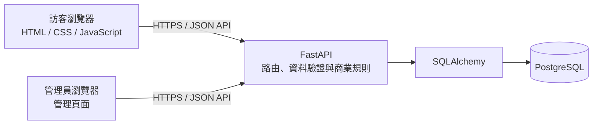
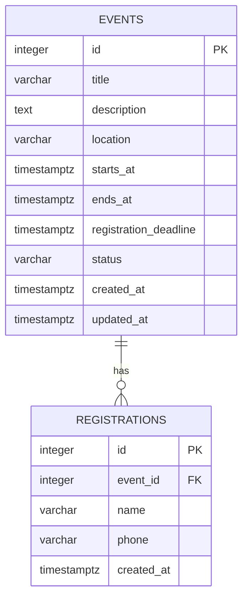

# 活動報名系統規劃

## 1. 專案目標

建立一個簡易的活動報名網站。訪客可以瀏覽可報名的活動、填寫姓名與聯絡電話完成報名，並查看活動報名名單；管理員可以新增活動、查看報名名單及停止報名。

本文件規劃基本版與 Pro 版的功能，並定義技術架構、資料表、API、驗證規則與建議的專案目錄。此規劃以課程專題的小型系統為目標，優先選擇容易實作、說明及部署的做法。

## 2. 技術選擇

| 層次 | 技術 | 用途 |
|---|---|---|
| 前端 | HTML、CSS、JavaScript | 顯示活動清單、活動資訊、報名表單及管理頁面 |
| 後端 | Python、FastAPI | 提供 REST API、驗證輸入、處理商業規則 |
| 資料庫 | PostgreSQL | 儲存活動與報名資料 |
| ORM | SQLAlchemy 2.x | 以 Python 類別操作資料表 |
| 資料驗證 | Pydantic | 驗證 API 請求與回應格式 |
| 資料庫版本管理 | Alembic | 記錄並套用資料表結構變更 |
| 本機執行 | Docker Compose（建議） | 一次啟動 FastAPI 與 PostgreSQL |

### 為什麼使用這些技術

- FastAPI 能直接以 Python 撰寫 API，並自動產生 Swagger 文件，適合展示與測試課程專題。
- PostgreSQL 能以唯一限制等資料庫規則保護資料，避免只靠前端檢查造成重複報名。
- SQLAlchemy 與 Alembic 將資料操作和資料表變更明確化，之後調整欄位時較容易追蹤。
- 目前規模不需要微服務、訊息佇列或快取；先以單一 FastAPI 應用程式降低建置與除錯成本。

## 3. 功能需求

### 3.1 基本版

1. 管理員新增活動，輸入活動名稱、介紹、地點、開始與結束時間。
2. 訪客瀏覽目前開放報名的活動清單。
3. 訪客選擇活動後，填寫姓名與聯絡電話送出報名。
4. 訪客可以查看該活動的報名名單（姓名與報名時間）。
5. 管理員可以查看活動報名名單，並將活動停止報名。

### 3.2 Pro 版

1. 活動清單與活動頁顯示目前報名人數。
2. 每場活動以「姓名 + 聯絡電話」作為重複報名判斷條件。
3. 管理員可設定報名截止時間；截止時間到達後，系統不接受新報名。

### 3.3 管理功能（課程簡易版）

本版本不實作管理員登入與登出。管理頁面直接呼叫管理 API，提供新增活動、停止報名及查看完整報名資料的功能。公開活動頁的報名名單只顯示姓名；管理 API 不驗證使用者身分，因此目前僅適合本機或課程展示，不應直接公開部署。

## 4. 系統架構



### 請求流程

1. 瀏覽器送出 HTTP 請求，例如取得活動清單或提交報名資料。
2. FastAPI 路由接收請求，Pydantic 檢查欄位格式。
3. 後端執行商業規則檢查，例如活動是否仍開放、是否重複報名。
4. SQLAlchemy 透過 PostgreSQL 讀取或寫入資料。
5. FastAPI 回傳 JSON 與適當的 HTTP 狀態碼，前端更新畫面。

## 5. 資料庫規劃

### 5.1 關聯概念



### 5.2 `events` 活動

| 欄位 | 型別 | 規則 | 說明 |
|---|---|---|---|
| `id` | `BIGINT` | 主鍵、自動產生 | 活動識別碼 |
| `title` | `VARCHAR(200)` | 必填 | 活動名稱 |
| `description` | `TEXT` | 可空 | 活動介紹 |
| `location` | `VARCHAR(255)` | 可空 | 活動地點 |
| `starts_at` | `TIMESTAMPTZ` | 可空 | 活動開始時間 |
| `ends_at` | `TIMESTAMPTZ` | 可空 | 活動結束時間 |
| `registration_deadline` | `TIMESTAMPTZ` | 可空 | 報名截止時間；Pro 功能 |
| `status` | `VARCHAR(20)` | 必填，預設 `open` | `open` 開放、`closed` 停止、`cancelled` 取消 |
| `created_at` | `TIMESTAMPTZ` | 必填，預設現在 | 建立時間 |
| `updated_at` | `TIMESTAMPTZ` | 必填，建立及更新時維護 | 最後更新時間 |

活動停止報名時更新 `status` 為 `closed`。活動資料保留在資料庫，讓管理員仍可查看過往活動與報名紀錄。

### 5.3 `registrations` 報名

| 欄位 | 型別 | 規則 | 說明 |
|---|---|---|---|
| `id` | `BIGINT` | 主鍵、自動產生 | 報名識別碼 |
| `event_id` | `BIGINT` | 外鍵 → `events.id`，必填 | 所屬活動 |
| `name` | `VARCHAR(100)` | 必填 | 報名者姓名 |
| `phone` | `VARCHAR(30)` | 必填 | 聯絡電話，使用文字型別以保留 `+`、前置零等格式 |
| `created_at` | `TIMESTAMPTZ` | 必填，預設現在 | 報名時間 |

資料庫限制與索引：

- `UNIQUE (event_id, name, phone)`：同一活動中，同姓名且同電話只能報名一次；不同活動可重複報名。
- `FOREIGN KEY (event_id) REFERENCES events(id) ON DELETE RESTRICT`：避免刪除仍有報名資料的活動。
- `INDEX (event_id, created_at)`：加快依活動查詢報名名單。
- 不提供硬刪除報名的功能；若未來需要取消報名，可新增取消狀態與時間欄位，保留紀錄。

### 5.4 報名截止判斷

接受報名前，後端需確認活動存在、`status = 'open'`，且 `registration_deadline` 為空或尚未到達。資料庫唯一限制是最後一道防線，後端仍應先回傳容易理解的錯誤訊息。

## 6. API 規劃

API 前綴：`/api/v1`。請求與回應格式使用 JSON；日期時間使用 ISO 8601，並包含時區資訊。

| 方法 | 路徑 | 使用者 | 用途 |
|---|---|---|---|
| `GET` | `/api/v1/events` | 訪客 | 取得活動清單；可用 `status` 篩選 |
| `GET` | `/api/v1/events/{event_id}` | 訪客 | 取得活動詳細資訊與目前報名人數 |
| `POST` | `/api/v1/events/{event_id}/registrations` | 訪客 | 提交活動報名 |
| `GET` | `/api/v1/events/{event_id}/registrations` | 訪客 | 取得只含姓名的公開報名名單 |
| `POST` | `/api/v1/admin/events` | 管理頁 | 新增活動（本版本不驗證登入） |
| `PATCH` | `/api/v1/admin/events/{event_id}` | 管理頁 | 更新活動資料或狀態，例如停止報名 |
| `GET` | `/api/v1/admin/events/{event_id}/registrations` | 管理頁 | 取得含聯絡電話的完整報名名單 |

### API 範例

新增報名：

```json
{
  "name": "王小明",
  "phone": "0912345678"
}
```

成功回應 `201 Created`：

```json
{
  "id": 42,
  "event_id": 7,
  "name": "王小明",
  "created_at": "2026-10-30T09:30:00+08:00"
}
```

錯誤回應建議：

| 狀態碼 | 情況 |
|---|---|
| `400 Bad Request` | 活動已停止或已超過報名截止時間 |
| `404 Not Found` | 活動不存在 |
| `409 Conflict` | 同一活動已存在相同姓名與電話的報名 |
| `422 Unprocessable Entity` | 必填欄位缺漏或格式錯誤 |

## 7. 主要頁面

1. **活動列表頁**：顯示活動名稱、時間、地點、開放狀態與目前報名人數；可進入活動頁。
2. **活動詳細頁**：顯示活動介紹與報名名單，若仍可報名則顯示姓名與電話欄位。
3. **報名結果提示**：顯示成功、重複報名或停止報名等明確結果。
4. **管理頁**：新增活動、查看活動報名人數及完整報名資料、停止報名；本版本不要求登入。

## 8. 建議專案目錄

```text
project/
├── app/
│   ├── main.py                 # 建立 FastAPI app、掛載路由
│   ├── core/
│   │   └── config.py           # 讀取環境變數與設定
│   ├── db/
│   │   ├── session.py          # PostgreSQL 連線與 Session
│   │   └── models.py           # SQLAlchemy 資料表模型
│   ├── schemas/                # Pydantic 請求與回應模型
│   ├── routers/                # 活動、報名與管理 API
│   └── services/               # 報名與活動狀態等商業規則
├── frontend/                   # HTML、CSS、JavaScript
├── alembic/                    # 資料庫版本遷移
├── docs/                       # 專題規劃與文件
├── .env.example                # 環境變數範例，不放資料庫密碼等機密
├── compose.yaml                # FastAPI 與 PostgreSQL 本機服務
└── requirements.txt            # Python 套件清單
```

## 9. 設定與安全

- 資料庫連線字串等機密設定放在環境變數或本機 `.env`，不提交到 Git。
- `.env.example` 只放無敏感資訊的欄位範例。
- 本版本的管理 API 未設定登入驗證，適合課程展示或本機環境；若要部署到公開網路，應先加入管理員驗證並使用 HTTPS。
- 使用 SQLAlchemy 參數化查詢，避免將使用者輸入直接拼成 SQL。
- 公開名單只回傳必要欄位；管理 API 因未驗證身分，回傳的完整名單可能被任何能連線的人讀取。
- 驗證姓名長度、電話長度與活動時間，並限制請求欄位大小。
- 資料庫帳號採最小權限原則；正式環境需備份 PostgreSQL 資料。

## 10. 建議實作順序

1. 建立 FastAPI 專案、環境設定及 PostgreSQL 連線。
2. 建立 SQLAlchemy 模型與 Alembic 初始遷移。
3. 實作公開活動清單與活動詳細 API。
4. 實作報名 API、重複報名限制及活動截止檢查。
5. 實作新增活動、查看完整名單與停止報名 API。
6. 製作 HTML 頁面並串接 API。
7. 使用 FastAPI Swagger（`/docs`）展示及手動操作 API，確認主要流程。
8. 撰寫專題操作說明，列出啟動服務及使用管理頁的方式。

## 11. 範圍與後續可擴充項目

目前規劃不包含管理員登入／登出、付款、Email／簡訊通知、候補名單、名額上限、多管理員角色或大型流量部署，因為目前課程需求不需要這些功能。若後續要公開部署，可加入管理員驗證；若需求增加，也可新增活動名額、報名取消或通知服務，再擴充資料表與 API。

